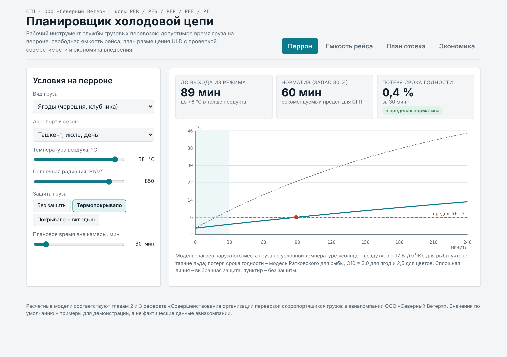

# Планировщик холодовой цепи

Веб-приложение для службы грузовых перевозок авиакомпании. Оно помогает планировать перевозку скоропортящихся грузов (коды PER, PES, PEP, PEF, PIL).



## Модули

| Раздел | Что делает |
|---|---|
| **Перрон** | Показывает, сколько минут груз может простоять у самолета до выхода из температурного режима. Учитывает вид груза, температуру воздуха, солнечную радиацию и вариант защиты. Выдает норматив с запасом 30 % и потерю срока годности. |
| **Емкость рейса** | Рассчитывает свободный объем и массу под груз после багажа для 7 типов ВС. Строит разброс P10/P50/P90 по 2000 смоделированным рейсам. |
| **План отсека** | Показывает 3D-схему нижней палубы A330 и B777 с позициями контейнеров AKE. Проверяет совместимость грузов и предельную загрузку отсеков. |
| **Экономика** | Считает NPV, IRR и срок окупаемости внедрения мероприятий при ваших допущениях. |

## Как запустить

- **Онлайн:** откройте ссылку GitHub Pages (адрес вида `https://<имя>.github.io/<репозиторий>/`).
- **Без интернета:** дважды щелкните `index.html`. Все работает локально, библиотека three.js лежит в папке `vendor`.

## Состав

```
index.html            приложение целиком (HTML + CSS + JavaScript)
vendor/three.min.js   библиотека 3D-графики three.js r128 (лицензия MIT)
favicon.svg           значок вкладки
.nojekyll             служебный файл для GitHub Pages
docs/                 скриншоты для этого описания
```

## Важно

Это независимая учебно-исследовательская разработка, а не официальный ресурс ООО «Северный Ветер». Значения по умолчанию – демонстрационные примеры. Фактические данные авиакомпании в приложении не используются.
