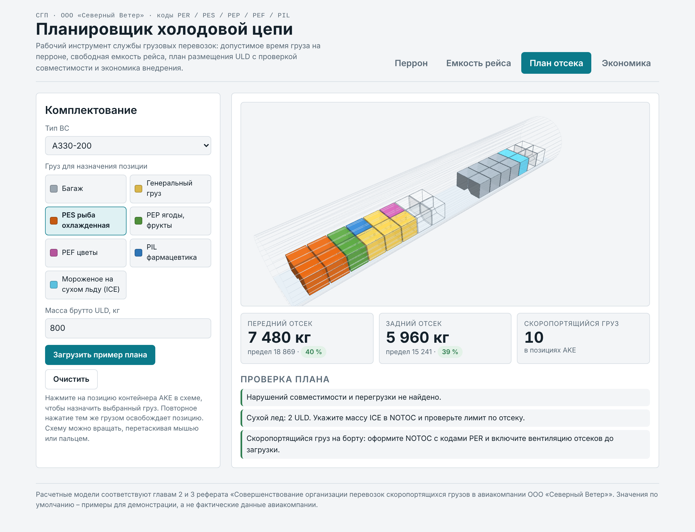

# Планировщик холодовой цепи

Веб-приложение для службы грузовых перевозок авиакомпании, которая возит скоропортящиеся грузы на пассажирских рейсах.

## Что умеет

**Перрон.** Показывает, сколько минут груз выдержит на солнце или морозе до выхода из температурного режима, с защитой и без нее. Модель учитывает нагрев по условной температуре «солнце и воздух» и таяние льда. Потеря срока годности считается по модели Ратковского и правилу Q10.

**Емкость рейса.** Рассчитывает свободный объем и массу после багажа для A321, A321neo, B737-800, A330 и B777, а также разброс по 2000 смоделированным рейсам.

**План отсека.** Показывает интерактивную 3D-модель Boeing 777-300ER с открывающимися грузовыми дверями, прозрачным фюзеляжем и позициями контейнеров AKE. Контейнеры заходят в отсеки в том порядке, в каком их грузят на перроне. План проверяется на совместимость грузов (цветы и фрукты, сухой лед) и на перегрузку отсеков. Для остальных типов пока показана схема нижней палубы.

**Экономика.** Считает NPV, IRR и дисконтированный срок окупаемости внедрения с настраиваемыми допущениями.

## Как устроено

Сайт статический, без сервера и сборки. `index.html` служит первой страницей, `planner.html` содержит планировщик, расчеты лежат в `assets/app.js`, 3D-модель в `assets/hold3d.js`. Светлая и темная (черно-белая) темы переключаются кнопкой в шапке. Переключатели сделаны в стиле «жидкого стекла»: бегунок можно схватить и перетащить.

## Автор

Понкратьева Александра Андреевна, студентка группы ТЛ3922 (Транспортная логистика), *Санкт-Петербургский государственный университет гражданской авиации имени Главного маршала авиации А. А. Новикова*, 2026.

Значения по умолчанию служат примером и не являются фактическими данными авиакомпании.

## Лицензии

Шрифт Montserrat распространяется по SIL Open Font License 1.1 (`assets/fonts/OFL-Montserrat.txt`), three.js r128 по лицензии MIT (`vendor/THREE-LICENSE.txt`).
